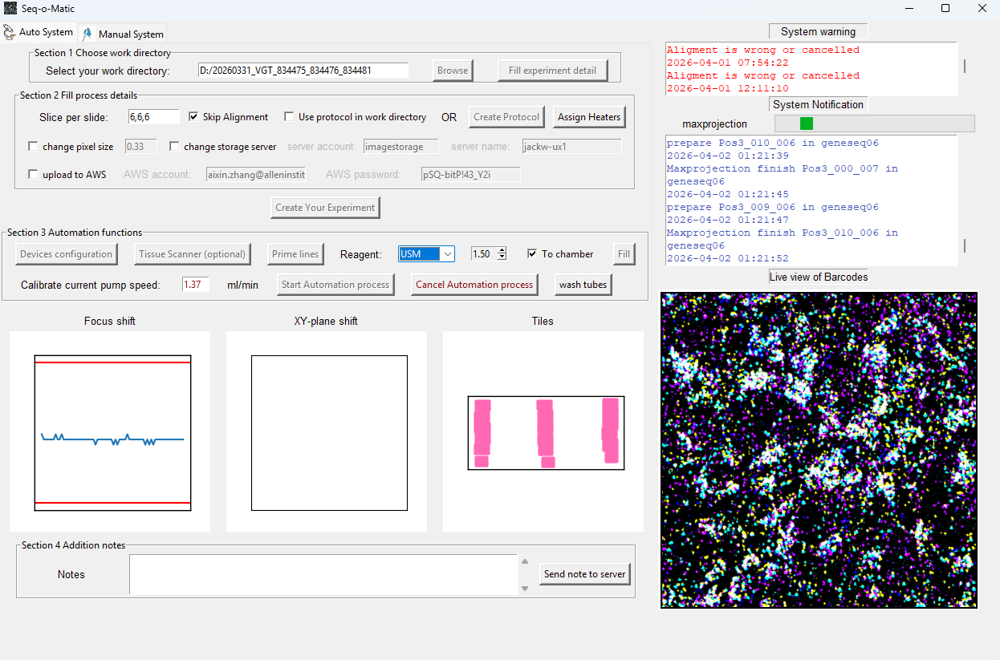

# Seq-o-Matic 2.5

**Automated Laboratory Platform for In situ Sequencing**

Seq-o-Matic is an integrated laboratory automation system for in situ sequencing (e.g. BARseq) workflows. It orchestrates fluidics exchange, microscope control, and image acquisition to enable fully automated multi-cycle sequencing experiments on tissue samples.




**Author:** Aixin Zhang
**Repository:** [BarseqLab/Seq_o_matics](https://github.com/BarseqLab/Seq_o_matics)

*** New seq-o-matic assisstant AI Agent is ready, it can assist you to install the env and answer all questions related to this system including hardware details, code details and control the system with human language, try "pump 1 ml pbst to chamber" or "heat chamber for 1 min at 60 c", the devices will work automatically follow your command! The project is published here:https://github.com/aixinzhang/Seq-o-Matic_AI_Assistant 
---

## Table of Contents

- [Overview](#overview)
- [Architecture](#architecture)
- [Hardware Requirements](#hardware-requirements)
- [Software Prerequisites](#software-prerequisites)
- [Installation](#installation)
- [Quick Start](#quick-start)
- [Project Structure](#project-structure)
- [Configuration](#configuration)
- [Experiment Workflow](#experiment-workflow)
- [For Developers](#for-developers)

---

## Overview

Seq-o-Matic manages three primary subsystems:

1. **Fluidics Exchange** -- Automated delivery of reagents (incorporation buffers, primers, wash solutions, DAPI, etc.) through a peristaltic pump and multi-port selector, with heating stage control for temperature-dependent reactions.

2. **Image Acquisition** -- Automated microscope control including autofocus, image registration/alignment between cycles, tile configuration, and multi-channel z-stack acquisition with max-intensity projection.

3. **Experiment Management** -- Protocol building, real-time logging, experiment metadata tracking, and result upload to network storage.

### Key Benefits

- Reduces manual operational burden, allowing scientists to focus on data analysis
- Minimizes human error in multi-step sequencing protocols
- Provides real-time monitoring with live image display and detailed logging
- Supports flexible experiment design through customizable protocol sequences

---

## Architecture

```
+-------------------------------------------+
|         GUI Layer (front_end/)             |
|  MainWindow | LogWindow | RecipeBuilder   |
|  ExperimentProfile | TissueScanner        |
+-------------------------------------------+
                    |
+-------------------------------------------+
|     System Orchestration (system/)         |
|  FluidicSystem       |  scope             |
|  (pump/selector/     |  (focus/align/     |
|   heater sequences)  |   tile/maxproj)    |
+-------------------------------------------+
                    |
+-------------------------------------------+
|       Device Abstraction (device/)         |
|  IsmatecPumpDevice | ElveflowMux          |
|  heat_stage_group  | KmtronicRelayCh4     |
+-------------------------------------------+
                    |
+-------------------------------------------+
|         Hardware Drivers (driver/)         |
|  Ismatec (serial)  | KmtronicRelay        |
|  PycromanagerCore (microscope via MMCore)  |
+-------------------------------------------+
```

For detailed architecture documentation, see [docs/architecture.md](docs/architecture.md).

---

## Hardware Requirements

| Device | Model | Interface | Purpose |
|--------|-------|-----------|---------|
| Peristaltic Pump | Ismatec IPC-N series | Serial (COM port) | Reagent delivery |
| Fluid Selector | Elveflow Multiplexer (x2, cascaded) | Serial (COM ports) | Reagent source selection (up to 16 reagents) |
| Heating Stage | Custom (x1-3 stages) | NI DAQ (analog/digital I/O) | Temperature-controlled reactions |
| Relay Controller | KMtronic 4-channel USB | Serial (COM port) | Flow path switching |
| Microscope | Nikon Ti2-E (or compatible) | Micro-Manager | Multi-channel fluorescence imaging |
| Piezo Stage | (Optional) | Via Micro-Manager | Z-stack acquisition |

---

## Software Prerequisites

- **Python** 3.9 - 3.11 (3.12+ not yet tested with all dependencies)
- **Micro-Manager** 2.0 (must be installed and configured for your microscope)
- **NI-DAQmx Driver** (for heating stage control via National Instruments hardware)
- **Operating System:** Windows 10/11 (required for NI-DAQmx and most microscope drivers)

---

## Installation

### Option A: Conda (recommended)

Conda handles all dependencies including compiled libraries (OpenCV, NumPy) in one step:

```bash
# 1. Clone the repository
git clone https://github.com/BarseqLab/Seq_o_matics.git
cd Seq_o_matics

# 2. Create the conda environment (installs Python + all dependencies)
conda env create -f environment.yml

# 3. Activate the environment
conda activate seq-o-matic
```

### Option B: Pip from requirements.txt (simplest)

```bash
git clone https://github.com/BarseqLab/Seq_o_matics.git
cd Seq_o_matics
pip install -r requirements.txt
```

### Vendored packages (pycromanager & ndtiff)

`pycromanager` and `ndtiff` are **bundled** in `code/supplementary/package/` and must **not** be installed via pip/conda. The application imports them from this vendored location. Do not run `pip install pycromanager` or `pip install ndtiff` -- it will conflict with the bundled versions.

If you need to update these packages, replace the folders in `code/supplementary/package/` with the new versions.

### Post-install setup

After installing Python dependencies:

1. **Install Micro-Manager 2.0** and configure it for your microscope hardware.
2. **Install the NI-DAQmx driver** from [ni.com](https://www.ni.com/en/support/downloads/drivers/download.ni-daq-mx.html) if using heating stages.
3. **Configure hardware connections** by editing the JSON files in `code/config_file/`. See [Configuration](#configuration) below.

---

## Quick Start

### For Lab Scientists

For the full hardware installation and day-of setup procedure (fluidics plumbing, chamber assembly, pump calibration, start and takedown), see the [Setup Guide](docs/setup_guide/Seq-o-matic_Setup_Guide.md) and its reagent calculator, [Automation_Workbook.xlsx](docs/setup_guide/Automation_Workbook.xlsx). In short:

1. Connect all hardware devices and power them on.
2. Launch Micro-Manager and load your microscope configuration.
3. Open a terminal in the `code/` directory and run:
   ```bash
   # If you used conda:
   conda activate seq-o-matic

   # Launch the application
   python mainwindow.py
   ```
4. In the **Auto System** tab:
   - Click **Browse** to select your experiment working directory, and fill in **Slice per slide**.
   - Click **Fill experiment detail** to fill in experiment metadata (brain name, probes, technician, etc.).
   - Click **Create Protocol** to build your protocol sequence, and **Assign Heaters** if needed.
   - Tick **Send to storage server** and/or **upload to AWS** if the data should be uploaded at the end of the run.
   - Click **Create Your Experiment**. This loads `storage.json` and tests the connections for the ticked uploads (see [Setting up another lab](#setting-up-another-lab-storagejson)).
   - Click **Devices configuration** to connect and test all hardware devices.
   - Click **Prime lines** to fill all fluidics lines with reagent.
   - Click **Start Automation process** (and confirm the pump speed) to begin the automated sequencing run.
5. Monitor progress in the log window. Live images and focus/alignment/tiling plots update in real time.

The **Manual System** tab runs one imaging cycle at a time (focus, align, tile, image and max projection as separate steps); it does not upload images (only the note, with **Send note to server**).

### For Developers

See the [Project Structure](#project-structure) and [For Developers](#for-developers) sections below.

---

## Project Structure

```
Seq_o_matics_2.5/
  pyproject.toml                     # Python package metadata (not used by the install options above)
  environment.yml                    # Conda environment definition
  requirements.txt                   # Pip dependencies
  README.md                          # This file
  docs/                              # Documentation
    architecture.md                  #   Detailed architecture & data flow
    config_files.md                  #   JSON config file schemas
    reagent_sequences.md             #   Protocol JSON format reference
    hardcoded_values.md              #   Per-microscope values still written in the code
    parity_inventory.md              #   Differences from the Elm reference program (with parity_inventory/)
    setup_guide/                     #   Hardware installation and day-of setup guide
      Seq-o-matic_Setup_Guide.md     #     The guide (figures in images/)
      Automation_Workbook.xlsx       #     Reagent calculator used by the guide
  dryrun/                            # Hardware-free dry-run harness (see dryrun/README.md)
    tests/                           #   Unit tests
  plans/                             # Development plans and status records
  code/
    mainwindow.py                    # Application entry point
    constants.py                     # Named constants (replaces magic numbers)
    types_seq.py                     # Shared TypedDicts and type aliases
    logging_config.py                # Python logging setup (TkHandler, file/console)
    config_file/                     # Hardware configuration JSONs
      IsmatecPumpDevice_pump.json    #   Pump serial port and tubing config
      ElveflowMuxDevice_selector.json #  Selector serial ports
      Heat_stage.json                #   DAQ channel assignments
      KMtronic_relay.json            #   Relay serial port
      Fluidics_Reagent_Components.json # Reagent-to-address mapping
      scope.json                     #   Microscope parameters
      storage.json                   #   AWS bucket and storage server for uploads
    logo/                            # GUI images
    device/                          # Hardware device wrappers
      base.py                        #   ABC interfaces (PumpDevice, SelectorDevice, etc.)
      Pump.py                        #   Ismatec pump (implements PumpDevice)
      Selector.py                    #   Elveflow multiplexer (implements SelectorDevice)
      Heatingstage.py                #   Heating stage via NI DAQ (implements HeaterDevice)
      Relay.py                       #   KMtronic relay stub (implements RelayDevice)
      pump_speed_calibration.txt     #   Pump speed calibration
      tissue_scanner/                #   Chamber and slide position files for the tissue scanner
    driver/                          # Low-level hardware protocols
      ismatec_ipc.py                 #   Ismatec serial command protocol
      kmtronic_relay.py              #   KMtronic serial command protocol
    front_end/                       # GUI components (Tkinter)
      Widgets.py                     #   Main window coordinator (delegates to panels)
      logwindow.py                   #   LogWindow singleton + notification functions
      experiment_profile.py          #   Experiment metadata dialog
      recipe_builder.py              #   Protocol sequence builder
      tissue_scanner.py              #   Tissue slide scanning & ROI selection
      automation_controller.py       #   Automation state machine (start_sequence, image_auto)
      panels/                        #   Focused UI panel modules
        workspace_panel.py           #     Directory selection, experiment profile
        experiment_config_panel.py   #     Slice/pixel/server/protocol settings
        device_panel.py              #     Device config popup
        fluidics_control_panel.py    #     Prime/fill/wash/start/cancel controls
        imaging_control_panel.py     #     Focus/align/tile/maxprojection controls
        status_panel.py              #     Plot canvases, notes, upload
    system/                          # High-level orchestration
      storage_settings.py            #   Loads and validates storage.json
      connection_check.py            #   AWS and storage-server checks run at Create
      fluidics_exchange_system.py    #   FluidicSystem facade (device connections)
      fluidics/                      #   Fluidics sub-package
        protocol_loader.py           #     Protocol type -> JSON file mapping
        sequence_runner.py           #     SequenceState enum
      imaging/                       #   Imaging sub-package
        imaging_system.py            #     ImagingSystem facade (composites managers)
        focus.py                     #     FocusManager (z-stack, autofocus)
        autofocus.py                 #     Focus-plane choice from the sharpness curve
        zstack_settings.py           #     Z-stack thickness settings from scope.json
        ndtiff_stack.py              #     Frame-by-frame NDTiff reader
        alignment.py                 #     AlignmentManager (phase correlation)
        tiling.py                    #     TilingManager (tile grid generation)
        max_projection.py            #     MaxProjectionManager (acquisition + projection)
        position_utils.py            #     Utility functions (position parsing, file I/O)
      image_acquisition_and_analysis_system.py  # Backward-compat shim -> imaging/
    reagent_sequence_file/           # Predefined fluidics protocols (JSON)
      Fluidics_sequence_*.json       #   Protocol definitions
      original_sequence_250um_gasket/ #  Original protocols (250um gasket)
      2IRM_and_2CRM_750um_gasket/    #   Variant protocols (double IRM/CRM, 750um gasket)
      750um gasket/                  #   Variant protocols (750um gasket)
    supplementary/                   # Vendored third-party packages (DO NOT pip install)
      package/pycromanager/          #   Micro-Manager Python bridge (bundled, not from PyPI)
      package/ndtiff/                #   ND-TIFF reader (required by pycromanager, bundled)
```

---

## Configuration

All hardware configuration is stored as JSON files in `code/config_file/`. See [docs/config_files.md](docs/config_files.md) for detailed schema documentation.

### Key Configuration Files

- **`scope.json`** -- Microscope name, safe stage positions, exposure times per channel, pixel size, z-direction, alignment channel, max-projection output drive, and the optional z-stack thickness and focus settings (`z_stack_thickness_um`, `z_step_um`, `focus_method`, ...; see [Z-stack thickness keys](docs/config_files.md#z-stack-thickness-keys)).
- **`IsmatecPumpDevice_pump.json`** -- Serial port, tubing diameter, pump ID.
- **`ElveflowMuxDevice_selector.json`** -- Serial ports for the two cascaded selectors.
- **`Fluidics_Reagent_Components.json`** -- Maps reagent names to selector addresses (1-16).
- **`Heat_stage.json`** -- DAQ device, analog output/input ports, digital output lines per heater.
- **`KMtronic_relay.json`** -- Serial port for the relay controller.
- **`storage.json`** -- Where data goes after a run: AWS bucket, S3 prefix, storage class, upload retries, and the storage server user, host and folder. See below.

### Setting up another lab (storage.json)

The AWS bucket and the storage server are set in `code/config_file/storage.json` (a single JSON object, UTF-8); nothing lab-specific is hardcoded.
There are no built-in defaults, so every key must be present:

| Key | Meaning |
|---|---|
| `aws_bucket` | S3 bucket for the end-of-run upload (letters, digits, `.`, `_`, `-`; no `s3://`) |
| `aws_prefix` | Optional folder inside the bucket (`""` for none; folder names separated by `/`, no leading `/`, no spaces) |
| `aws_storage_class` | Passed to `aws s3 cp --storage-class`; one of `STANDARD`, `REDUCED_REDUNDANCY`, `STANDARD_IA`, `ONEZONE_IA`, `INTELLIGENT_TIERING`, `GLACIER`, `DEEP_ARCHIVE`, `GLACIER_IR` |
| `aws_upload_retries` | Attempts per file (integer, 1 to 10) |
| `server_user`, `server_host` | Default ssh account and host (host name or IPv4 address, no `user@` or `:port`). The GUI fields are pre-filled with these; tick **Send to storage server** (or **change storage server** on the manual tab) to edit them for a run |
| `server_root` | Folder on the server that receives the data; must start and end with `/`, with no spaces, quotes or `//` |

`aws_bucket`, `server_user` and `server_host` may not start with `-` (scp/ssh would read it as an option).

On the microscope PC:

1. Install the AWS CLI and run `aws configure` (or set up a profile) with credentials that can write to the bucket. The GUI's AWS account/password fields are not used.
2. Set up ssh key login to the storage server (`ssh user@host` must work without a password; the end-of-run upload cannot ask for one).
3. Edit `storage.json`.

When **Create Your Experiment** is clicked, the program loads `storage.json`:

- A missing or invalid file, or a missing or unknown key (for example a typo), shows an error and **stops the experiment from being created**, on both tabs.
- On the **Auto System** tab, it then tests the connections that are ticked (AWS: CLI, credentials and bucket access; server: key login and a writable `server_root`). A "Please wait" window stays open until the experiment is created; meanwhile the rest of the program, the upload boxes and the server fields cannot be used. A failed test shows an error naming the box to untick and **stops the experiment from being created**. The tests do not write anything, so write permission on the bucket is not checked.
- On the **Manual System** tab, no connection is tested (manual runs do not upload images).
- If `storage.json` was edited while the program is open, the server user/host fields follow the file unless they were changed by hand.

---

## Experiment Workflow

A typical automated sequencing experiment follows this workflow:

```
1. SETUP
   Set work directory -> Enter experiment metadata -> Build or select protocol sequence
   -> Create experiment (loads storage.json, tests the ticked uploads) -> Configure devices

2. PRIME
   Fill all fluidics lines with reagent to remove air bubbles

3. FOR EACH CYCLE IN PROTOCOL:

   a) FLUIDICS EXCHANGE (e.g., bcseq01, geneseq02+, HYB, strip)
      Load JSON protocol -> Execute steps sequentially:
        pump: Select reagent source -> Pump specified volume
        heat_device: Heat sample for specified duration (typically 180s)
        wait: Incubate without pumping for specified duration
        stopper: End of sequence

   b) IMAGE ACQUISITION (imagecycleXX)
      Focus:  Autofocus via z-stack sharpness analysis
      Align:  Register to reference cycle (imagecycle00) via phase correlation
      Tile:   Generate tile grid configuration
      MaxProj: Acquire multi-channel z-stacks -> Compute max-intensity projections
               -> Write them to <maxproject_drive>\<experiment>_maxprojection\<cycle>\

4. UPLOAD (end of an automated run, only what was ticked at Create)
   Send to storage server: ssh mkdir -p, then scp -r the _maxprojection folder to <server_root>
   upload to AWS:          pack each cycle folder into <cycle>.tar.zst -> aws s3 cp to the bucket
```

For reagent sequence format documentation, see [docs/reagent_sequences.md](docs/reagent_sequences.md).

---

## For Developers

### Entry Point

The application launches from `code/mainwindow.py`:
1. `Log_window` creates the root Tkinter window and log panels
2. `window_widgets` initializes all UI controls, device connections, and orchestration systems
3. `mainwindow.mainloop()` starts the Tkinter event loop

### Threading Model

The application uses multi-threading to keep the GUI responsive:
- **Main thread**: Tkinter event loop (all GUI updates)
- **Fluidics thread**: `FluidicSystem.startSequence()` runs a `threading.Timer`-based state machine
- **Imaging threads**: Separate threads for focus, alignment, tiling, and max-projection
- **Heating threads**: One thread per heating stage for parallel temperature monitoring

Synchronization uses `threading.Event` objects (`cycle_done_event`, `start_image_event`) for efficient blocking waits, replacing the older polling-loop pattern.

### Logging

The application uses Python's standard `logging` module alongside the program's own log methods:
- **Console**: Structured output `2026-03-30 14:23:05 [INFO] seqomatic.fluidics: message`
- **log.txt** (in the work directory): the program's own log lines (`write_log`), once each. The `logging` module does not write to it: `setup_logging()` is called without a log file, so its `FileHandler` is not attached.
- **GUI panels**: Color-coded messages via custom `TkHandler` (purple for fluidics, blue for scope, red for errors)

Logger hierarchy: `seqomatic.fluidics`, `seqomatic.scope`, `seqomatic.device.pump`, `seqomatic.device.heater`, `seqomatic.device.selector`, `seqomatic.driver.ismatec`.

### Key Classes

**GUI Layer:**

| Class | File | Responsibility |
|-------|------|---------------|
| `window_widgets` | `front_end/Widgets.py` | Main window coordinator (delegates to panels) |
| `LogWindow` | `front_end/logwindow.py` | Singleton log/notification panel |
| `AutomationController` | `front_end/automation_controller.py` | Automation state machine orchestration |
| `WorkspacePanel` | `front_end/panels/workspace_panel.py` | Directory selection, experiment profile |
| `FluidicsControlPanel` | `front_end/panels/fluidics_control_panel.py` | Prime/fill/wash/start/cancel controls |
| `ImagingControlPanel` | `front_end/panels/imaging_control_panel.py` | Focus/align/tile/maxprojection controls |

**System Layer:**

| Class | File | Responsibility |
|-------|------|---------------|
| `FluidicSystem` | `system/fluidics_exchange_system.py` | Device connections facade + sequence execution |
| `load_protocol()` | `system/fluidics/protocol_loader.py` | Protocol type -> JSON file mapping |
| `SequenceState` | `system/fluidics/sequence_runner.py` | Enum: IDLE, RUNNING, CANCELLED, FINISHED |
| `ImagingSystem` | `system/imaging/imaging_system.py` | Imaging facade (composes managers below) |
| `FocusManager` | `system/imaging/focus.py` | Z-stack acquisition, autofocus |
| `AlignmentManager` | `system/imaging/alignment.py` | Phase correlation image registration |
| `TilingManager` | `system/imaging/tiling.py` | Tile grid generation |
| `MaxProjectionManager` | `system/imaging/max_projection.py` | Multi-channel acquisition + max projection |
| `StorageSettings` | `system/storage_settings.py` | Loads and validates `storage.json`; builds server paths and S3 URIs |
| `check_all()` | `system/connection_check.py` | AWS and storage-server connection checks (`check_aws`, `check_server`) |

**Device Layer:**

| Class | File | Responsibility |
|-------|------|---------------|
| `PumpDevice` (ABC) | `device/base.py` | Pump interface |
| `IsmatecPumpDevice` | `device/Pump.py` | Ismatec pump (implements PumpDevice) |
| `ElveflowMux` | `device/Selector.py` | Cascaded selector (implements SelectorDevice) |
| `heat_stage_group` | `device/Heatingstage.py` | Multi-stage heating (implements HeaterDevice) |
| `Ismatec` | `driver/ismatec_ipc.py` | Ismatec pump serial protocol |
| `KmtronicRelay` | `driver/kmtronic_relay.py` | KMtronic relay serial protocol |

### Tests and Dry Run

Unit tests live in `dryrun/tests/` and use `unittest`. Run them from the repository root, in the conda environment from `environment.yml`:

```bash
python -m unittest discover -s dryrun/tests -t .
```

The storage tests (`test_storage_settings`, `test_storage_callsites`) need no numpy or pytz, so they also run with a plain Python that has Tk (tested with 3.10 and 3.13).

`dryrun/` also holds a dry-run harness that runs the whole program, GUI included, with every device replaced by a fake, and compares two versions of the code device by device. See [dryrun/README.md](dryrun/README.md). A full scenario set writes about 50 GB of scratch.

### Adding a New Protocol

1. Create a new JSON file in `code/reagent_sequence_file/` following the format in [docs/reagent_sequences.md](docs/reagent_sequences.md).
2. Add an entry to `PROTOCOL_MAP` in `system/fluidics/protocol_loader.py` with a matching lambda condition and filename.
3. Add the protocol option to the recipe builder dropdown if needed.
